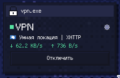
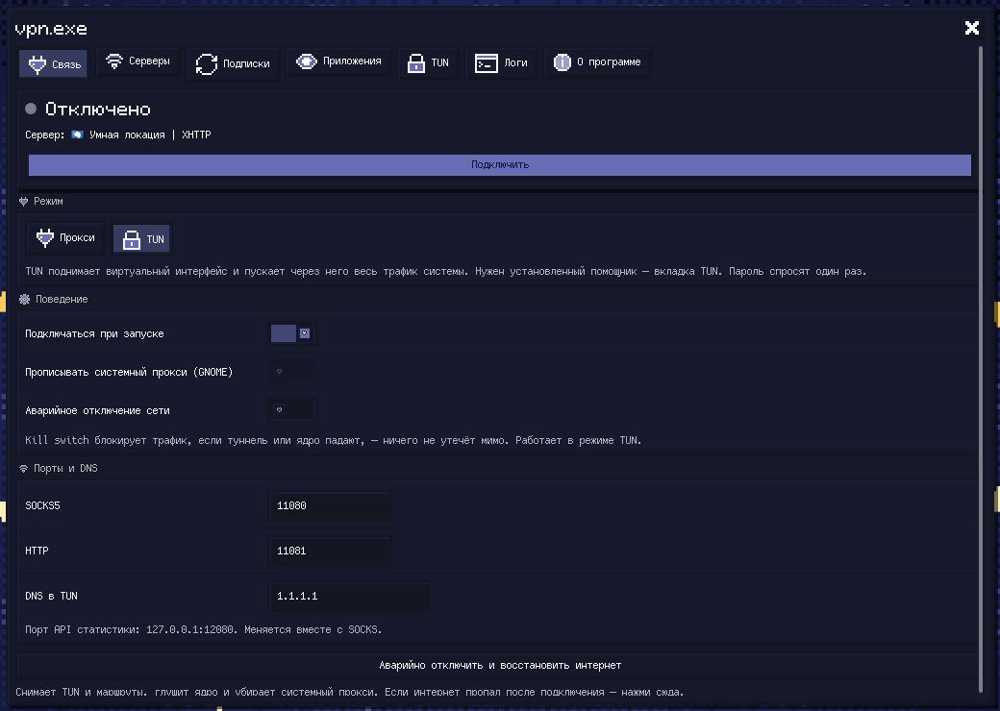
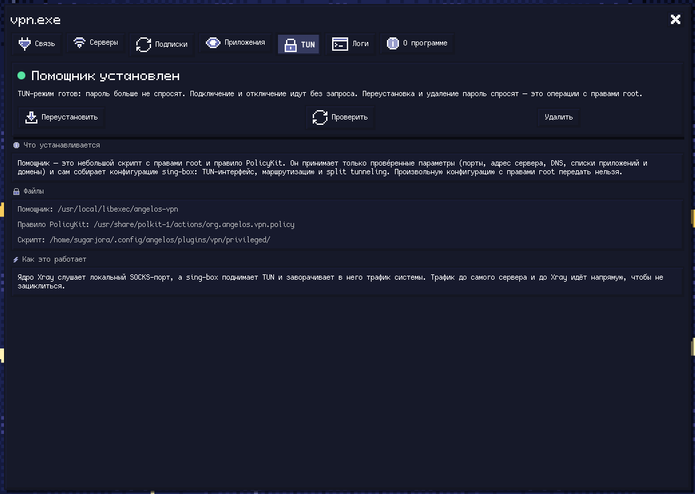

# VPN — angelOS plugin

A VPN client for angelOS, built on Xray and sing-box. It reads the same
subscription keys as Fortuna / Happ, lets you pick a location, pings the
servers, and can push the whole system through the tunnel (TUN) — with a
password asked **once**.

- **Desktop widget** — status, the chosen server, its address, live speed, a switch.
- **Bar pill** — left click connects / disconnects, right click opens the window.
- **A full window** — the gear on the widget, the bar pill's right click, or
  `angelos run vpn settings`. The same tabs also live in **Settings → VPN**.
- **Tabs**: Connection, Servers, Subscriptions, Apps (split tunneling), TUN,
  Logs, About.

## Screenshots

The bar pill: status, the chosen server, live speed, and a switch.



The **Connection** tab — server choice, TUN / proxy mode, autoconnect, ports and DNS.



The **TUN** tab — what the privileged helper is, where it lives, and how to check it.



The **About** tab — version, engine paths, IPC commands and licences.


## Installation

### Through the plugin manager

The usual way. Open **Settings → Plugins**, find **VPN**, and install. It appears
in the launcher with a settings entry (`angelos run vpn settings`).

Updates arrive the same way: when a new version is released it shows up there
after the registry moderators approve it. Nothing else to do.

### Manually

```sh
git clone https://github.com/SugarJora/angelos-vpn.git
cd angelos-vpn
./pack.sh                    # builds ../vpn-v<version>.zip
```

Copy the built plugin directory into your angelOS config, or install the archive
by hand:

```sh
mkdir -p ~/.config/angelos/plugins/vpn
unzip -q vpn-v1.1.0.zip -d ~/.config/angelos/plugins/vpn
```

Then reload the shell — `qs -c angelos ipc call angelos reload`.

### The privileged helper (TUN mode)

Proxy mode needs nothing. TUN mode needs a root helper, and **it must be
installed once**. From the plugin directory:

```sh
PLUGIN=~/.config/angelos/plugins/vpn
pkexec sh -c "$PLUGIN/privileged/install.sh --remove && $PLUGIN/privileged/install.sh"
```

You can also let the plugin's **TUN** tab do it — it offers the same action and
shows where the helper is installed.

This matters after **every update that changes the helper**. The installer
deliberately refuses to overwrite an existing one: it records a SHA-256 of the
file it installed and rejects anything that does not match byte for byte, so a
binary swapped between the password prompt and the exec cannot run as root. The
price is that changing the helper means `--remove` first, and one more password
prompt.

## How it works

Two engines are looked up on the machine, not assumed (see *Requirements*):

- **Xray** runs the subscription config for VLESS / XHTTP and the rest. It
  listens on a local SOCKS (default `11080`) and HTTP (`11081`) port.
- **sing-box** brings up the TUN interface and sends system traffic to Xray's
  SOCKS port. It is only used in TUN mode.
- **Hysteria2 is the exception**: sing-box speaks it natively, so in TUN mode it
  carries those servers itself and Xray is not started at all. In proxy mode the
  same servers go through Xray, which also speaks the protocol.

Modes:

- **Proxy** — nothing privileged. Apps pointed at `127.0.0.1:11080` (SOCKS5)
  or `127.0.0.1:11081` (HTTP) use the tunnel. Optionally the GNOME/KDE system
  proxy is set for you, and your previous proxy settings are restored on
  disconnect.
- **TUN** — a virtual interface routes everything. The privileged helper does
  this; installing it asks for the password once, after which `up` / `down` run
  without a prompt.

The controller (`Vpn.qml`, a QML singleton) owns the subscription fetch, the
server list, the core process, the traffic counters and the helper calls. Every
piece of UI binds to it. Traffic counters read Xray's own API, so they are shown
for every server except Hysteria in TUN mode, where there is no Xray to ask —
the panel stays empty rather than reporting an error over a working tunnel.

## TUN: one password, then never again

`privileged/install.sh` installs, as root:

- `/usr/local/libexec/angelos-vpn` — the helper (Python 3, root).
- `/usr/local/libexec/angelos-vpn-install` — a root-owned copy of the installer
  itself, so later installs and removals never run a file the user can write.
- `/usr/share/polkit-1/actions/org.angelos.vpn.policy` — two PolicyKit actions:
  `org.angelos.vpn.helper` (`allow_active=yes`, no password after the install)
  and `org.angelos.vpn.install` (always asks, because it runs as root).

The helper takes **only validated arguments** — two port numbers, one host
name, one DNS address, two comma-separated lists (apps, domains), a kill-switch
flag, the sing-box path, and for Hysteria a path to a credentials file — and
builds the sing-box config itself. No caller-supplied configuration ever reaches
root.

Hysteria credentials arrive as a **file, not as arguments**. Anything in `argv`
is readable by any local process through `/proc` for as long as the tunnel is up,
and that password is the whole of the server's authentication. The plugin writes
it `0600` to the plugin's cache directory; the helper requires the path to be
inside that directory, rejects a file other users can read, re-validates every
field on the way in, and deletes it as soon as it has been read. The home
directory it compares against comes from `PKEXEC_UID`, which polkit sets and the
caller cannot forge.

The generated tunnel:

- routes `127.0.0.1` traffic from the **`xray` process** directly (so its link
  to the server can never loop through the tunnel), plus the resolved server IPs
  and private networks; for Hysteria there is no Xray, so that rule is left out
  and sing-box exempts its own process;
- hijacks **only port 53** for DNS and sends those queries through the proxy;
- sends your chosen apps (by process name) and domains (suffixes) directly, when
  split tunneling is on;
- refuses **UDP 443** (QUIC): it cannot cross either transport — the provider
  breaks it through XHTTP and QUIC-in-QUIC through hysteria fails at the
  handshake — and an unanswered attempt makes a browser hang instead of falling
  back, so pages load over TCP immediately. Apps and domains marked direct keep
  their QUIC on the physical interface;
- everything else goes to Xray's SOCKS port — or, on a Hysteria server, straight
  into the Hysteria2 outbound;
- **Kill switch** (`strict_route`) blocks leaks if the tunnel drops.

### Trust and updating

Running a binary as root is the one thing this helper exists to get right, so:

- the **subscription is treated as untrusted input**. Its `inbounds` are thrown
  away and rebuilt (loopback only) and its `dns` is replaced with your own —
  otherwise a provider could open an unauthenticated proxy on `0.0.0.0` or point
  every lookup at itself;
- the **helper binary is pinned by SHA-256** in `/usr/local/libexec/angelos-vpn.sha256`
  (root-owned, `0444`). Any later install must match it byte for byte;
- an **update therefore means "Remove", then "Install" again** — the password
  is asked once more. That is the trade for not being able to bootstrap trust
  out of `$HOME`;
- the sing-box path passed in is rejected if it is relative, not a regular file,
  not executable, group/world-writable, or owned by the calling user.

### The tunnel cannot outlive the shell

sing-box is started in its own session, so it survives angelOS — and `qs kill`
ends the shell natively rather than exiting the application, so no
`Component.onDestruction` runs. Left alone, quitting angelOS while connected in
TUN mode would keep the interface up and the machine offline until a reboot.

The helper therefore starts a **watchdog** of its own: while an angelOS shell is
running it does nothing, and the moment the last one is gone it takes the tunnel
down. Typical case: about two seconds, no reboot.

Recognising "an angelOS shell" means matching the running quickshell process, by its
executable rather than only by the `-c angelos` argument: once Quickshell is running it
rewrites its own process title and that argument is no longer in `/proc`. Matching on
the argument alone made the watchdog tear down a live tunnel on a working desktop.

And because the tunnel can still go away for reasons the watchdog did not cause, the
plugin asks the helper whether it is still up every 15 seconds while connected in TUN
mode. Without that the panel went on reading "connected" after the interface was gone,
and traffic left the machine unencrypted. The question is put to the helper rather than
to the network: a passing outage should not be mistaken for a dead tunnel.

## The subscription

`Subscriptions.js` understands both shapes a Happ-style endpoint can return:

- an **Xray config** (object or array) — the Fortuna default for a `v2rayNG`
  User-Agent;
- a **base64 list** of `vless://` / `vmess://` / `trojan://` / `ss://` URIs,
  including the SIP002 `ss://method:pass@host:port` form.

Hysteria2 servers arrive inside the Xray-config form. Recent Xray-core speaks
the protocol natively, salamander obfuscation included, so they work in both
modes — but in TUN mode the engine is switched: sing-box takes those servers and
Xray is left out, so its connection to the server is not routed back through the
tunnel that depends on it. A protocol neither engine can implement is reported as
unsupported rather than listed as a server that fails at connect time.

The URL carries a secret, so it is masked in the UI and only revealed on demand.

## The device id (HWID)

The HWID is `angelos-` + `/etc/machine-id` (falling back to
`/var/lib/dbus/machine-id`, then to a generated value that is stored). It is
stable for the life of the install and is sent to the provider as one machine.
It is **never** spoofed or rotated: the provider's device limit is respected.

## Requirements

- angelOS 2.0 or newer, with Quickshell.
- `xray` and `sing-box`. Happ's copies under `/opt/happ` are used when present;
  anything in `PATH`, `/usr/bin` or `/usr/local/bin` works too. The plugin finds
  them at startup and says in **About** what it could not find.
  `xray` is not needed for a Hysteria2 server in TUN mode — sing-box carries it
  on its own — but every other protocol still goes through Xray, and proxy mode
  always does.
- `python3`, `curl`, `ss`, `pkexec`, `getent`, `sh`.

Proxy mode needs none of the privileges: install the helper only if you want TUN.

## IPC

`angelos run vpn <command>` — target `vpn`:

| command | does |
| --- | --- |
| `toggle` | connect or disconnect |
| `connect` | connect |
| `disconnect` | disconnect |
| `settings` | open the window |
| `refresh` | refetch the active subscription |
| `addsub <url>` | add a subscription |
| `ping` | ping every server |
| `status` | report the current status |
| `panic` | the emergency brake: tear everything down at once |
| `logs` | write the full log and diagnostics to the cache |
| `select <n>` | choose server *n* from the list (0-based) |

`select` only changes the chosen index and reconnects the way the UI does; it never touches
the TUN directly. Note that switching is not instantaneous — a reconnect takes a few seconds,
and the tunnel can briefly drop while it happens.

## Removing the helper

Settings → VPN → TUN → **Remove**, or:

```sh
sudo privileged/install.sh --remove
```

which also takes a running tunnel down.

## Tests

Five suites run offline, without touching the network:

```sh
python3 test/test_probe.py     # the ping probe: argument handling and the deadline
node    test/test_subscriptions.js   # the parser, against hostile and modern inputs
node    test/protocol_matrix.js      # every protocol, validated by `xray run -test`
python3 test/probe_deadline.py       # the probe's deadline under a wedged resolver
python3 test/test_helper_config.py   # the TUN helper's config: both engines, rule order,
                                     # the credentials file, and `sing-box check`
```

A sixth lives in the repository but not in the release archive, because it reaches the
provider's servers on purpose — it answers "does this server actually carry traffic", which
`xray run -test` cannot:

```sh
python3 test/test_all_servers.py 3 6   # every server in the active subscription, live
```

## License

MIT — see [LICENSE](LICENSE).